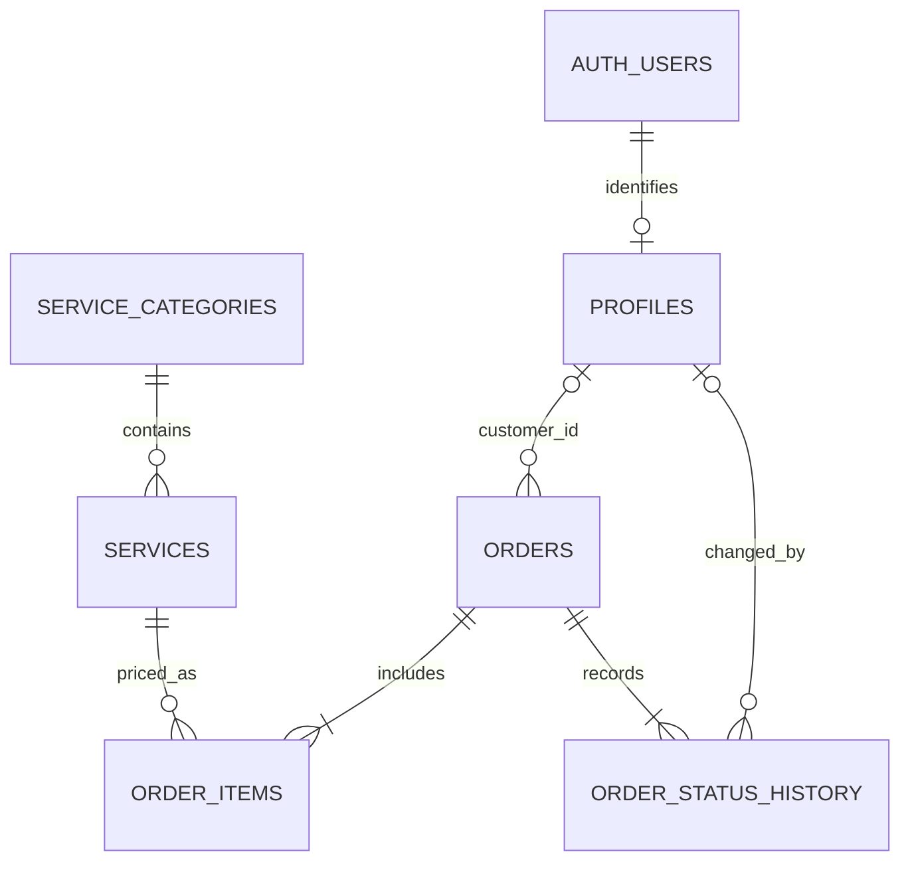
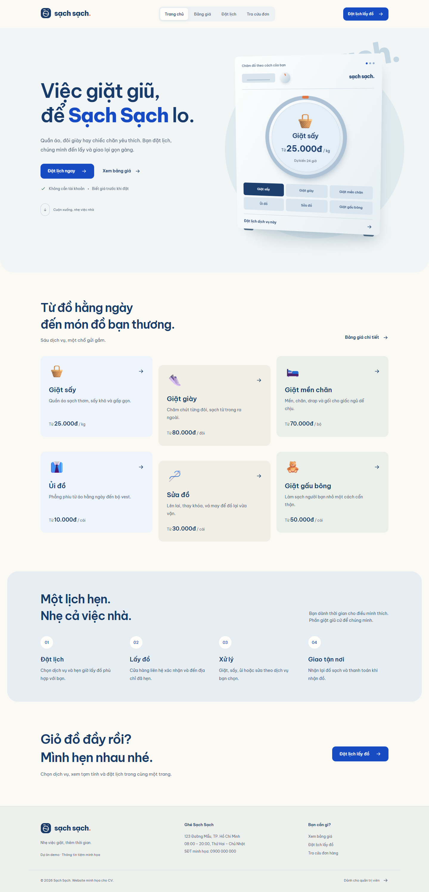
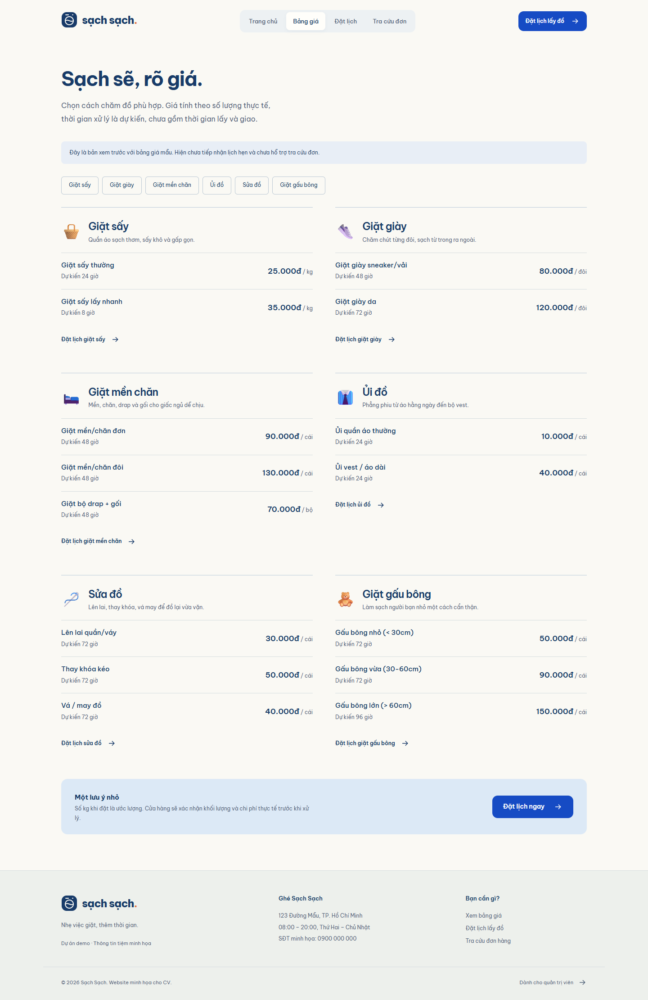
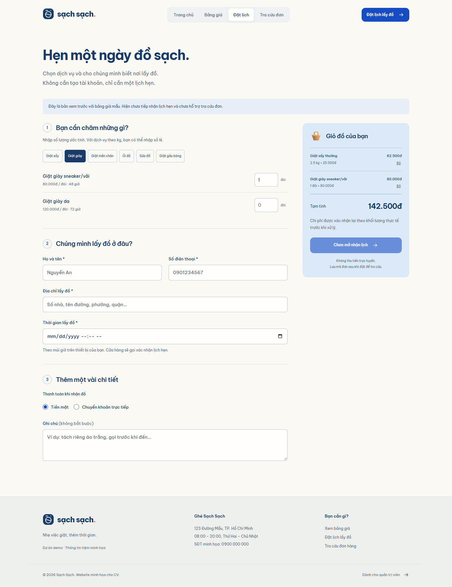
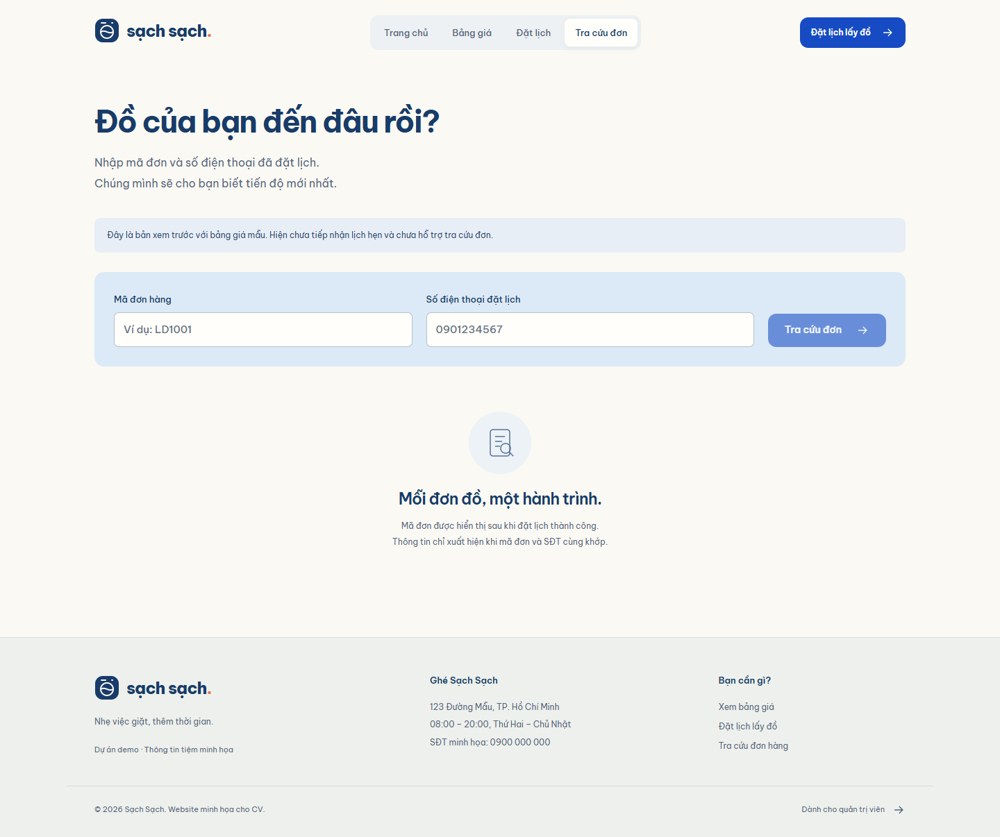

# Sạch Sạch · Laundry Service Web

Website demo cho CV: khách chọn dịch vụ, đặt lịch lấy đồ không cần tài khoản, nhận mã đơn và theo dõi tiến độ bằng mã + SĐT. Admin đăng nhập để lọc đơn và cập nhật trạng thái.

**Stack:** Next.js App Router · TypeScript · Tailwind CSS · Supabase Postgres/Auth · Vercel.

**Demo online:** chưa triển khai; cần cấu hình Supabase và kết nối GitHub/Vercel. Hiện chạy được giao diện cục bộ với bảng giá mẫu. Tên tiệm, địa chỉ và SĐT là minh họa.

## Chạy cục bộ

Yêu cầu Node.js 22 LTS và npm.

```bash
npm ci
npm run dev
```

Mở [localhost:3000](http://localhost:3000). Không có biến môi trường: xem được trang chủ, bảng giá, chọn dịch vụ và tạm tính; nút gửi đơn/tra cứu/đăng nhập bị khóa, không tạo dữ liệu đơn giả.

## Chức năng

- Sáu nhóm, 15 mức giá: giặt sấy, giặt giày, mền chăn, ủi đồ, sửa đồ, giặt gấu bông.
- Chọn nhiều nhóm, tạm tính, đặt lịch guest, thanh toán tiền mặt/chuyển khoản khi nhận đồ.
- Giá từ DB; RPC tạo đơn và chi tiết trong **cùng một transaction**, bỏ qua giá client.
- Tra cứu khớp đồng thời mã và SĐT, xem chi tiết và timeline; phản hồi không lưu cache.
- Admin: Supabase Auth, kiểm tra role tại từng trang và thao tác server, tìm mã/SĐT, lọc trạng thái, tối đa 100 đơn mới nhất.
- Chuyển trạng thái tuần tự; hủy ở hai bước đầu. RPC khóa hàng, kiểm tra trạng thái cũ để tránh ghi đè, trigger ghi lịch sử và người cập nhật.
- Mobile-first, menu di động, hỗ trợ bàn phím/focus, reduced motion, font Be Vietnam Pro tự host qua npm.
- Trang chủ dùng bảng máy giặt CSS với hiệu ứng nghiêng theo cuộn, bộ chọn dịch vụ trong lồng và bố cục thẻ mềm. Đã hoàn tác phiên bản WebGL theo lựa chọn của người dùng. Reduced motion giữ góc nhìn tĩnh; mobile không ghim màn hình.

## Kết nối Supabase

1. Tạo project Supabase mới. Trong SQL Editor, chạy lần lượt [schema.sql](supabase/schema.sql) rồi [functions.sql](supabase/functions.sql). Schema giữ nguyên bảng, RLS, seed và trigger của PIPELINE; functions bổ sung hai transaction chỉ `service_role` được gọi. Chạy một lần trên DB mới, không chạy lặp như migration.
2. Sao chép `.env.local.example` thành `.env.local` và điền đủ:

```dotenv
NEXT_PUBLIC_SUPABASE_URL=
NEXT_PUBLIC_SUPABASE_ANON_KEY=
SUPABASE_SERVICE_ROLE_KEY=
```

Lấy URL/anon key tại Project Settings → API và service role key trong API keys. **Service role key chỉ dùng server**, helper có `import "server-only"`. Không thêm tiền tố `NEXT_PUBLIC_` cho khóa này. `.env.local` được gitignore, example được commit.

3. Authentication → Users → Add user: tạo email/mật khẩu, xác nhận email và lấy UUID. Chạy:

```sql
insert into profiles (id, full_name, role)
values ('THAY_BANG_UUID_CUA_USER', 'Admin demo', 'admin');
```

4. Khởi động lại app và vào `/admin/login`.

**Tài khoản demo đề xuất để tự tạo:** `admin@sachsach.example` / `SachSachDemo#2026`. Đây là thông tin minh họa, **chưa có tài khoản hoạt động** vì chưa kết nối Supabase. Chỉ dùng trong project demo riêng chứa dữ liệu giả, không dùng mật khẩu tài khoản thật. Nếu công khai admin demo, người xem có quyền thay đổi đơn demo.

## Trang & API

| Đường dẫn            | Chức năng                                     |
| -------------------- | --------------------------------------------- |
| `/`                  | Trang chủ, chọn nhanh dịch vụ                 |
| `/bang-gia`          | Giá theo nhóm, Server Component               |
| `/dat-lich`          | Form guest và giỏ đồ                          |
| `/tra-cuu`           | Mã đơn + SĐT, chi tiết, timeline              |
| `/admin/login`       | Supabase Auth                                 |
| `/admin`             | Tìm kiếm và lọc đơn                           |
| `/admin/orders/[id]` | Chi tiết, chuyển trạng thái                   |
| `POST /api/orders`   | Validate, gọi transaction, trả `{code,total}` |
| `POST /api/track`    | Trả dữ liệu khi khớp mã và SĐT                |

`pending → picked_up → processing → ready → delivered`. `pending` và `picked_up` có thể chuyển `cancelled`. Không chuyển lùi/mở lại đơn.

Khối lượng theo kg khi đặt là ước lượng; thời gian xử lý là dự kiến. Giờ hẹn nhập theo múi giờ thiết bị, lưu UTC, hiển thị theo `Asia/Ho_Chi_Minh`. Tiền làm tròn đến đồng, dạng `25.000đ`. Cửa hàng xác nhận khối lượng trước khi xử lý; demo không có giao diện chỉnh khối lượng hoặc thanh toán trực tuyến.

## Sơ đồ dữ liệu



Public chỉ đọc danh mục/dịch vụ đang hoạt động qua RLS. Orders, items, history, profiles không có public policy. API dùng service role; admin được xác thực và kiểm tra role trước khi truy cập DB.

## Ảnh giao diện

Ảnh thật từ production cục bộ, chế độ chưa kết nối Supabase; giỏ đồ chứa lựa chọn minh họa. Trang chủ đã trở về thiết kế máy giặt CSS trước khi đổi sang WebGL.


| Trang chủ                               | Bảng giá                                  |
| --------------------------------------- | ----------------------------------------- |
|  |  |

| Đặt lịch                                  | Tra cứu                                   |
| ----------------------------------------- | ----------------------------------------- |
|  |  |

## Xác minh

`npm run build` kiểm tra TypeScript và build production; `npm start` chạy production. Không thêm test tự động theo PIPELINE.

Đã xem năm trang công khai trên Chromium 1440px/390px, menu mobile, bộ chọn dịch vụ, giỏ đồ đa nhóm (`2,5 kg × 25.000đ + 1 đôi × 80.000đ = 142.500đ`), trạng thái thiếu cấu hình và redirect hai trang admin khi chưa đăng nhập. Không thấy lỗi JavaScript/tràn ngang ở các trang đã kiểm tra.

Schema và RPC đã chạy trên PostgreSQL cục bộ tạm thời ngoài dependency dự án: tổng đơn ba nhóm `242.500đ`, đúng/sai SĐT, timeline/actor, từ chối chuyển lùi/hủy muộn, rollback khi dịch vụ không tồn tại, quyền RPC. **Chưa thay thế kiểm tra tích hợp Supabase.** Kết quả và checklist: [VERIFICATION.md](docs/VERIFICATION.md).

`npm audit --omit=dev`: 0 vulnerability tại thời điểm kiểm tra. Audit đầy đủ còn 5 cảnh báo high trong dev-tool ESLint → fast-glob → micromatch → braces; registry chưa có bản braces mới để cập nhật trực tiếp. Không dùng `audit fix --force` vì gợi ý hạ eslint-config-next về major 14. Theo dõi khi cập nhật công cụ phát triển.

## Deploy Vercel

1. Tạo repo GitHub `laundry-service-web` và push thư mục này, bỏ qua `.env.local`.
2. Vercel → Add New Project → import repo. Framework **Next.js**, root thư mục này, build `npm run build`.
3. Thêm đủ ba biến môi trường. Supabase cần đã chạy cả hai file SQL và tạo admin.
4. Deploy; Supabase → Authentication → URL Configuration: đặt domain Vercel thực tế vào Site URL.
5. Kiểm tra toàn bộ checklist trên domain thật. Điền link demo thật và tài khoản đã xác nhận vào README trước khi gửi CV.

Phiên này chưa được cung cấp remote GitHub, tài khoản Vercel hoặc cấu hình Supabase; chưa có domain để xác minh. Các bước bên ngoài còn để trống trong [PIPELINE.md](PIPELINE.md).

Thiết kế: [PRODUCT.md](PRODUCT.md), [DESIGN.md](DESIGN.md). Cookie SSR theo [hướng dẫn Supabase](https://supabase.com/docs/guides/auth/server-side/creating-a-client?framework=nextjs).
